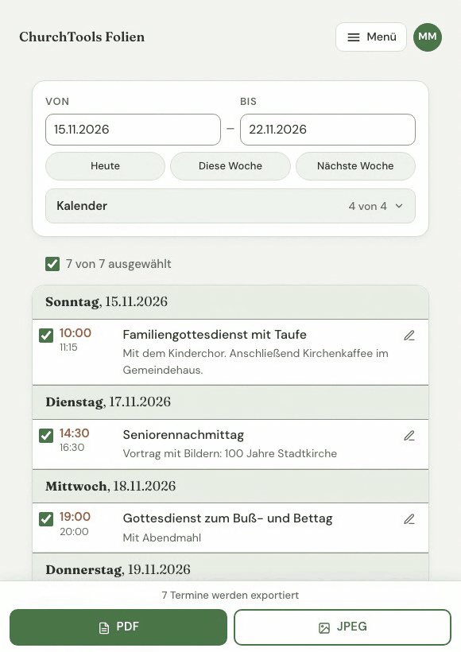
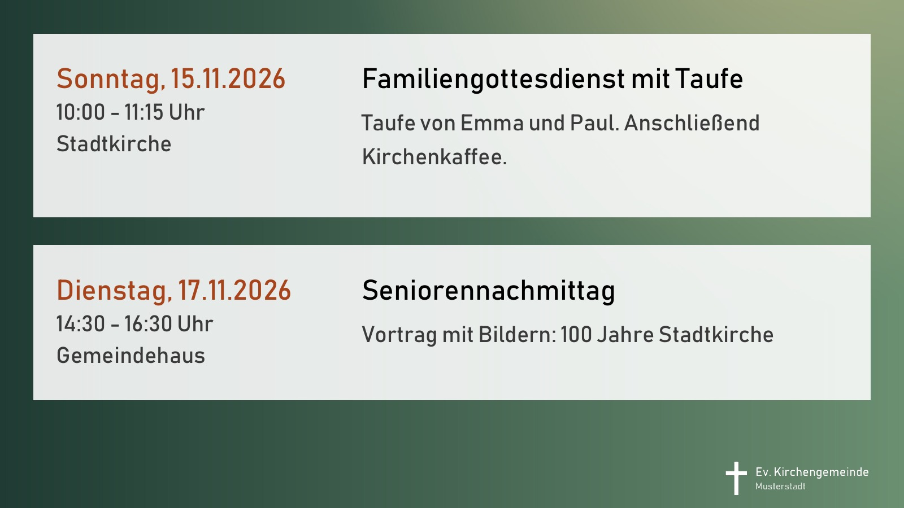
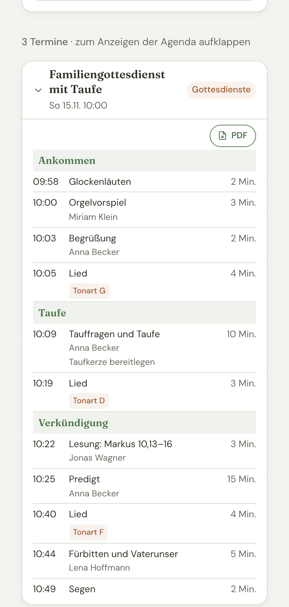
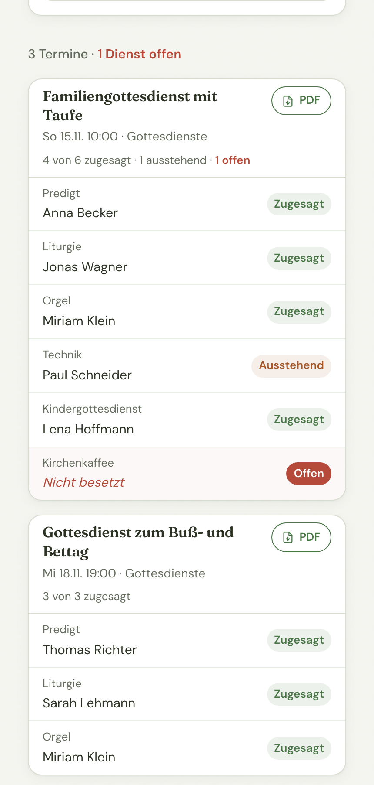

# ChurchTools Folien

[](https://github.com/schowave/churchtools-api/actions/workflows/test-and-build.yml)
[](https://hub.docker.com/r/schowave/churchtools)
[](https://www.python.org/downloads/)
[](LICENSE)

Turn the appointments in your [ChurchTools](https://www.church.tools/) calendars into announcement slides for the service, and print agendas and rotas, without copying anything by hand. Log in with your ChurchTools account, pick a week and export PDF or JPEG.

<p align="center">
  
</p>

## Contents

- [Features](#features)
- [Quick start](#quick-start)
- [Configuration](#configuration)
- [Deployment](#deployment)
- [Security and privacy](#security-and-privacy)
- [Development](#development)
- [License](#license)

## Features

**Termin-Folien** (announcement slides). Loads the appointments of the chosen calendars and date range and lays them out as 16:9 slides, as many per slide as fit. You can:

- leave out single appointments
- replace the ChurchTools description with your own text for the slide; it is stored and comes back the next time the appointment is loaded
- set the box, date and text colors and the box opacity, and upload a background image and a logo, with a live preview
- export a PDF, or a ZIP with one JPEG per slide for presentation software that does not take PDFs

<p align="center">
  
</p>

**Agenda.** Shows the service rundown of each event (songs with key, items with start time, duration and responsible persons) and exports it as PDF.

**Dienstplan** (rota). Shows who serves in which role per event, highlights pending and unfilled services, and exports a PDF per event.

<p align="center">
  
  &nbsp;&nbsp;
  
</p>

The interface is in German and works on phones as well as on desktops.

## Quick start

You need a ChurchTools instance and a login for it. The app reads the public calendars of that instance and the events you have access to.

### Docker (recommended)

```bash
docker run -d \
  -e CHURCHTOOLS_BASE=your-instance.church.tools \
  -v ./data:/app/data \
  -p 5005:5005 \
  schowave/churchtools:latest
```

Open [http://localhost:5005](http://localhost:5005) and log in with your ChurchTools credentials.

### From source

Requires [mise](https://mise.jdx.dev/), which installs Python and uv.

```bash
git clone https://github.com/schowave/churchtools-api.git
cd churchtools-api
cp .env.example .env           # set CHURCHTOOLS_BASE
mise install                   # installs Python + uv, creates .venv
mise run install               # installs app + dev dependencies
mise run run
```

## Configuration

All settings are environment variables.

| Variable | Required | Default | Description |
|---|---|---|---|
| `CHURCHTOOLS_BASE` | Yes | — | Your ChurchTools domain (e.g. `my-church.church.tools`) |
| `DB_PATH` | No | `churchtools.db` | Path to the SQLite database file |
| `TIMEZONE` | No | `Europe/Berlin` | Timezone for date display (any valid IANA timezone) |
| `LOG_FORMAT` | No | `console` | Log output format: `console` (human-readable) or `json` |
| `FORWARDED_ALLOW_IPS` | No | `127.0.0.1` | Addresses of reverse proxies whose `X-Forwarded-*` headers are trusted (read by uvicorn). See [Behind a reverse proxy](#behind-a-reverse-proxy) |
| `ALLOWED_GROUP_IDS` | No | — | Comma-separated ChurchTools group ids; only active members may use the app. See [Restricting access](#restricting-access) |
| `ALLOWED_PERSON_IDS` | No | — | Comma-separated ChurchTools person ids that may use the app (in addition to the groups) |

Colors, logo and background image are shared by everyone who logs in: there is one set of settings per installation, and each export saves the colors used.

### Restricting access

Without `ALLOWED_GROUP_IDS` and `ALLOWED_PERSON_IDS`, everyone with a login for your ChurchTools instance can use the app and change the shared design. To limit that, set one or both:

- `ALLOWED_GROUP_IDS=12` lets active members of group 12 in (a pending membership request does not count). The id is in the group's URL in ChurchTools, e.g. `.../groups/12/dashboard`.
- `ALLOWED_PERSON_IDS=7,42` lets these people in. Each user sees their id on the profile page ("ChurchTools-ID").

People without access get a clear message at login; sessions of people who lose access end within five minutes.

## Deployment

The Docker image `schowave/churchtools` is built for `linux/amd64` and runs on any x86_64 host with Docker or Podman. Mount a volume at `/app/data`: it holds the database with the design settings, uploaded images and custom texts.

```yaml
# docker-compose.yml
services:
  churchtools-api:
    image: schowave/churchtools:latest
    ports:
      - "5005:5005"
    volumes:
      - ./data:/app/data
    environment:
      - CHURCHTOOLS_BASE=your-instance.church.tools
      - DB_PATH=/app/data/churchtools.db
    restart: unless-stopped
```

### Synology NAS

1. Create a project folder on your NAS (e.g. `/volume1/docker/churchtools/`).
2. Copy [`docker-compose.yml`](docker-compose.yml) from this repository into it.
3. Create a `.env` file next to it:

   ```env
   CHURCHTOOLS_BASE=your-instance.church.tools
   ```

4. In **Container Manager** → **Project** → **Create**, point to the folder and start the project.

### Automatic updates

[`docker-compose-watchtower.yml`](docker-compose-watchtower.yml) runs [Watchtower](https://github.com/nicholas-fedor/watchtower). It checks Docker Hub every five minutes and updates containers labelled `com.centurylinklabs.watchtower.enable=true`, which the app's `docker-compose.yml` sets. New releases then go live without manual steps.

### Behind a reverse proxy

When the app runs behind a reverse proxy (Synology reverse proxy, Traefik, nginx, Caddy), set `FORWARDED_ALLOW_IPS` to the proxy's address as seen from the container, for example its Docker network address or `*` if the container port is only reachable through the proxy. Without it the app sees every request as coming from the proxy over HTTP:

- the login rate limit counts all users as one client, so a few failed logins lock everyone out for five minutes
- cookies are not marked `Secure` and no HSTS header is sent

Do not set `*` if port 5005 is reachable directly: clients could then fake their IP address and bypass the login rate limit.

## Security and privacy

- The app logs in against your ChurchTools instance; it has no user accounts of its own. The ChurchTools login token stays on the server, encrypted with a key that only the user's session cookie can unlock.
- Every page is served with a strict Content Security Policy, and fonts are self-hosted, so visitors' browsers contact no third parties.
- The container starts as root only to hand the data volume to the unprivileged `app` user, then runs the app as that user.
- Each release image is scanned with [trivy](https://trivy.dev/) before it is pushed to Docker Hub.

## Development

Tooling is managed with [mise](https://mise.jdx.dev/) (`mise.toml`): it pins Python and uv and activates `.venv` automatically. Run `mise tasks` for the full list.

| Command | Description |
|---|---|
| `mise run install` | Install app and dev dependencies into `.venv` |
| `mise run run` | Run migrations and start dev server with auto-reload |
| `mise run test` | Run test suite |
| `mise run cov` | Run test suite with coverage report |
| `mise run lint` | Check code style (ruff) |
| `mise run format` | Auto-fix code style |
| `mise run audit` | Check pinned runtime dependencies for known vulnerabilities (pip-audit) |
| `mise run smoke` | Start the built image and check health, login page and static files |
| `mise run scan` | Scan the locally built image for fixable HIGH/CRITICAL vulnerabilities (trivy) |
| `mise run login` | Log in via browser against the running app and save the session to `.auth/` for scripted checks |
| `mise run login-clear` | Delete the saved session (contains your ChurchTools login token) |
| `mise run preview` | Render a sample slide PDF to `app/saved_files/preview.pdf` |
| `mise run lock` | Regenerate `requirements.txt` (pinned, hashed runtime deps for the Docker image) |
| `mise run build` | Build container image locally (podman) |
| `mise run run-docker` | Build and run the container locally with `./data` as volume |

Local JPEG export needs poppler (`brew install poppler` / `apt install poppler-utils`); the Docker image ships it.

Dependencies are declared in `pyproject.toml`. After changing them, run `mise run lock` so the Docker image picks up the new pins.

CI runs lint, tests, the dependency audit, and the image scan on every push to `main` and on pull requests.

### Releasing

1. Go to **Actions** → **Release** → **Run workflow**.
2. Enter a version number (e.g. `3.1.0`), or leave it empty to increment the patch version (e.g. `3.0.2` → `3.0.3`).
3. The workflow runs lint, tests and the dependency audit, updates `pyproject.toml`, builds, smoke-tests and scans the Docker image (linux/amd64), and only then creates the git tag, pushes the image to Docker Hub and creates the GitHub release.
4. Watchtower picks up the new image on connected hosts.

The workflow needs the GitHub secrets `DOCKERHUB_USERNAME` and `DOCKERHUB_TOKEN`.

## License

[Apache License 2.0](LICENSE)
